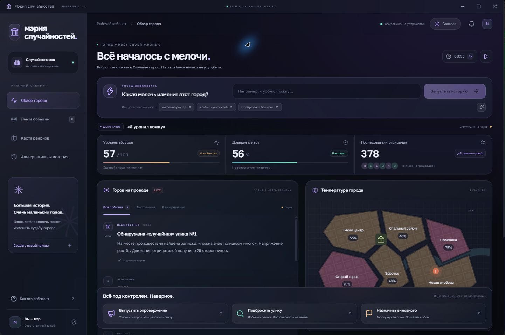

# Мэрия случайностей — Windows-приложение

Приложение работает автономно: интерфейс, шрифты, карта и движок находятся внутри исполняемого файла. Браузер, Node.js, аккаунт ChatGPT и подключение к сети для игры не нужны.



## Запуск

Откройте `release/MayorOfChaos-1.0.0.exe`. Установка и права администратора не требуются. Доступна также распакованная версия: `release/win-unpacked/MayorOfChaos.exe` (ей нужна вся папка `win-unpacked`).

Введите бытовое событие или выберите пример. Новая городская сводка появляется каждые 12 игровых секунд. Три действия мэра влияют на районы, доверие, абсурд и последующие новости. В верхнем правом углу доступны пауза, скорость и переключение чёрной/светлой темы.

Город и тема сохраняются автоматически в профиле `%APPDATA%/MayorOfChaos`. Хронику можно экспортировать из окна «Альтернативная история» через стандартный диалог Windows. Запуск нового кризиса заменяет текущую историю.

Это процедурный прототип: внешняя языковая модель не подключена.

## Разработка

Понадобятся Node.js 22.13+ и Windows x64 для сборки исполняемого файла.

```powershell
npm install
npm run desktop:renderer
npm run desktop:start
```

Полная сборка portable EXE:

```powershell
npm run desktop:build
```

Проверки:

```powershell
npx tsc --noEmit
npm run check:simulation
```

`desktop/main.cjs` — процесс Windows-приложения; `desktop/preload.cjs` — ограниченный мост управления окном и экспорта; `desktop/renderer.tsx` — точка входа интерфейса. `app/page.tsx` и `app/globals.css` содержат интерфейс, `lib/simulation.ts` — движок города.

Сборка использует Electron с изоляцией контекстов, sandbox и отключённой интеграцией Node.js в интерфейсе. Файлы загружаются через локальный протокол `mayor://app/`, сервер не запускается. Сборка прототипа без цифровой подписи.
